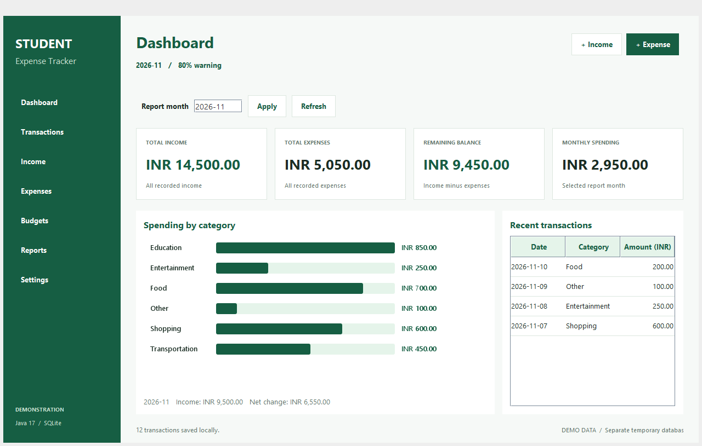

# Student Expense Tracker

A Java 17 desktop application for tracking a student's income, expenses and monthly spending limit in Indian rupees. Cash purchases, allowance and freelance payments can share one ledger, even when the computer is offline.



## Run on Windows 10 or 11

Install Java 17 or newer. If you have the runnable distribution, extract the ZIP and double-click **Run-Tracker.bat**. Choose **Run-Demo.bat** to explore fictional records in a separate temporary database.

To build from the source in this repository, install JDK 17 and Maven 3.9, open PowerShell and run:

```powershell
git clone https://github.com/SathwikGadchanda/student-expense-tracker-java-3.git
cd student-expense-tracker-java-3
mvn clean verify
java -jar target/student-expense-tracker.jar --demo
```

Omit `--demo` to enter and keep your own transactions. The source launcher is `run-windows.bat`. The initial Maven build needs internet access or a populated dependency cache. The shaded JAR includes SQLite JDBC.

## What you can do

| Screen | Available actions |
| --- | --- |
| Dashboard | Compare lifetime income, expenses and balance with spending in the selected month. Read the four most recent entries and category chart. |
| Transactions, Income and Expenses | Add, edit, delete, sort by date, search descriptions or categories, and restrict results to the report month. Export the entire ledger to CSV. |
| Budgets | Enter or revise a monthly limit. See spending and the amount left. The status changes at 80%, at the exact limit and above the limit. |
| Reports | Review income versus expenses, daily and weekly totals, spending by category and monthly expense history. Weeks begin on Monday. The weekly tab counts only days inside the report month. |
| Settings | View the active storage location and currency. Choose whether recent entries appear on the dashboard. |

**Try it.** In an empty ledger, add INR 5,000 as Pocket Money and INR 120.50 as Food in the same month. The balance should be INR 4,879.50. Set a budget of INR 150 for that month. The remaining budget is INR 29.50 and the 80% warning appears.

## Architecture and storage

The Swing forms create validated transaction objects. `FinanceService` calculates summaries and filters rows. `SqliteTransactionDao` implements the transaction repository interface, and `BudgetDao` stores monthly limits. JDBC prepared statements bind user input. Each SQLite connection enforces foreign keys.

```text
src/main/java/com/studentfinance/
  App.java       Application entry point and demo switch
  ui/            Swing forms, navigation, tables and chart
  service/       Filtering and financial summaries
  model/         Transaction, transaction type, category and budget
  dao/           Ledger queries and budget persistence
  database/      SQLite setup and migration
  util/          Currency, CSV and synthetic demo data
src/test/java/   JUnit integration tests, GUI smoke check and restart probe
docs/            Diagrams, screenshots, test evidence and presentation guides
```

The three tables are `categories`, `transactions` and `budgets`. Transactions reference a valid category for their type. A month identifies one budget. Amounts are read as BigDecimal and stored and summed in integer paise. The first launch also upgrades databases from the original tracker in one transaction. [Schema and diagrams](docs/DESIGN.md)

Real data is saved to `%USERPROFILE%\.student-expense-tracker\expenses.db`. Close the app before copying this file for a backup. To use another file, run `java "-Dexpense.tracker.db=C:\MyData\expenses.db" -jar target/student-expense-tracker.jar`. Demo mode always uses a new temporary directory. CSV files contain all records, including entries hidden by a search.

## Testing and project materials

Run `mvn clean verify` for the JUnit suite. [Verification results](docs/TESTING.md) · [Live demonstration](docs/DEMO.md) · [30 viva questions](docs/VIVA.md) · [Budget screen](docs/screenshots/budgets.png) · [Reports screen](docs/screenshots/reports.png)

## Scope and future improvements

This version serves one person on one computer. It uses INR, holds the ledger in memory for reporting and relies on the operating system to protect the unencrypted database. Useful future additions include CSV import with a preview, recurring entries and encrypted backups. The desktop application runs locally. A screen recording can demonstrate it to a remote evaluator.

Code is available under the [MIT license](LICENSE). Dependencies retain their own licenses.
