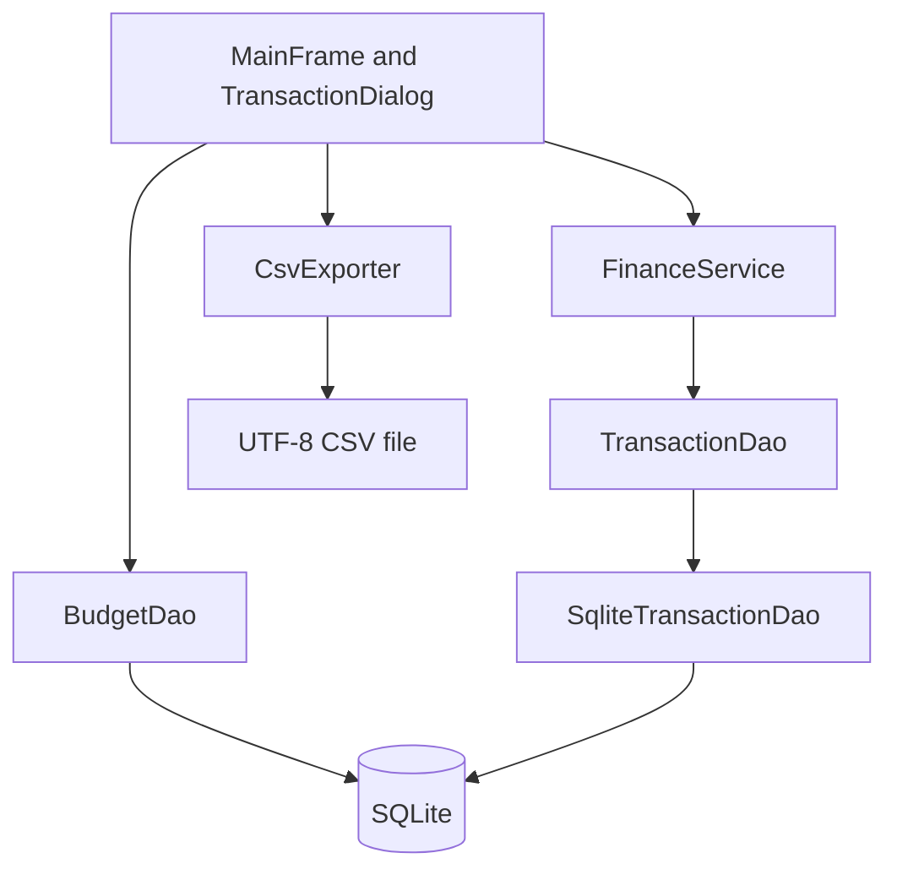
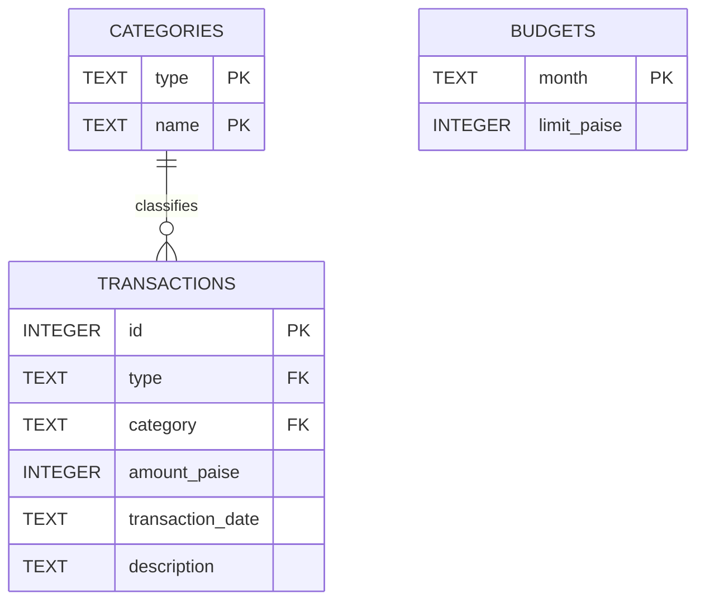

# System design

## Application architecture

Swing's event thread handles input and drawing. A SwingWorker runs database reads and writes. The completion handler updates the table, budget state and chart. The demo uses the same components with a different database file.

## Entity relationship diagram

The category key is the pair (type, name). A transaction references this pair using (type, category), so Other can belong to both types. Budgets are independent of individual transactions. The report groups expense dates by year and month before comparing the sum with that month's limit. A month may contain expenses before a budget has been entered.

| Table | Integrity and retrieval |
| --- | --- |
| categories | Both key columns are required. Type must be INCOME or EXPENSE. Categories are seeded during migration. |
| transactions | Positive integer amount up to 100,000,000 paise. Date and category are required. Description can be empty and has a 250-character maximum. The date index supports date ordering. |
| budgets | Unique YYYY-MM key, positive integer limit up to 100,000,000 paise. A single upsert creates or updates a limit. |

## Classes and responsibilities

| Class | Purpose |
| --- | --- |
| App | Select the database, initialize schema, seed demo records when requested, and show the window. |
| Database | Open SQLite connections, enable constraints and migrate the original ledger atomically. |
| Transaction and TransactionType | Hold a validated, immutable record and identify its direction. |
| Category | Keep income and expense choices consistent between forms, domain validation and schema initialization. |
| Budget | Compare a month's expense total with a limit in paise. |
| TransactionDao and SqliteTransactionDao | Define ledger operations and implement them using JDBC. |
| BudgetDao | Read and save one spending limit per month. |
| FinanceService and FinanceSummary | Filter the ledger and produce monthly, weekly, daily and category totals. |
| MainFrame and TransactionDialog | Handle navigation and collect transaction values. |
| TransactionTableModel and CategoryChartPanel | Adapt transaction objects to Swing's table and paint category bars. |
| Money, CsvExporter and DemoData | Parse and format currency, export an escaped CSV, and create isolated demonstration records. |

## Accounting examples

An expense of INR 120.50 becomes 12,050 paise. With an INR 150 budget, the 80% threshold is INR 120.00. Spending of exactly INR 150 reaches the budget, and spending of INR 150.01 exceeds it. Income increases the balance but does not reduce monthly spending. Weeks start on Monday and are clipped to the selected month.
